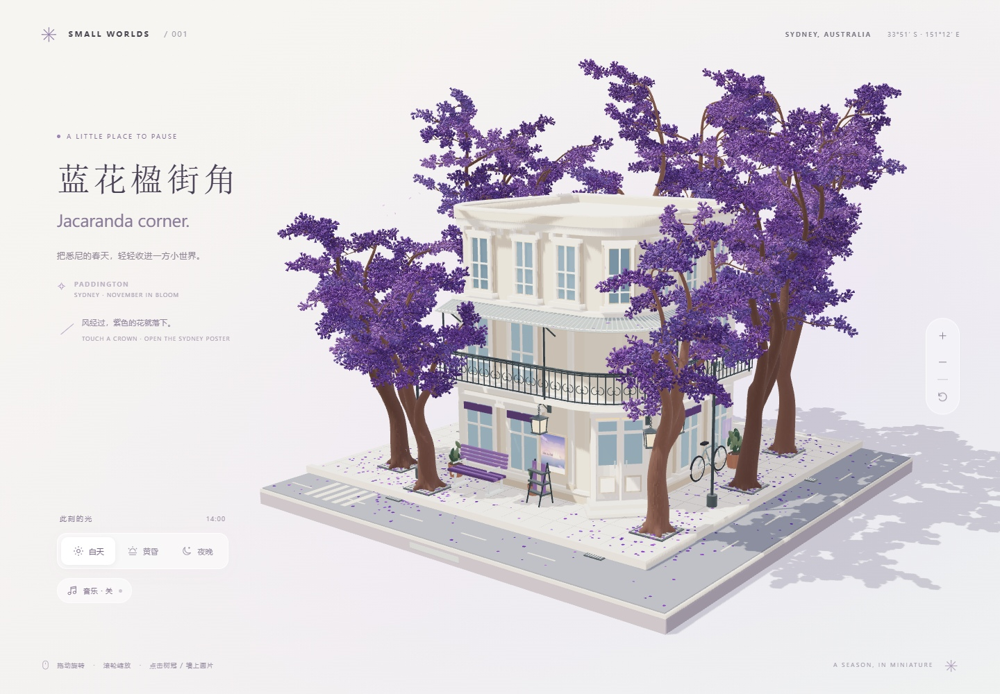

# 蓝花楹街角 · Jacaranda Corner

一方以悉尼 Paddington 历史街区为灵感的 Three.js 微缩街角。建筑、街道、七棵蓝花楹、铁艺阳台、双扇门、长椅与街灯均为程序化建模；不依赖外部贴图或模型资源。



仓库包含完整源码、照片与音乐素材、测试脚本、最终预览，以及可离线打开的 `jacaranda-corner.html`。设计分析与复用提示词见 [制作提示词](制作提示词.md)。开发依赖、临时缓存和重复压缩包不纳入版本管理。

## 运行

需要 Node.js 20.19+ 或 22.12+；推荐使用当前受支持的 LTS 版本。

```bash
npm ci
npm run dev
```

打开 `http://127.0.0.1:5173/`。

生产构建：

```bash
npm run build
```

一次构建会顺序生成两种版本，并自动更新根目录的离线成品：

| 用途 | 构建目录 | 大小与资源 |
| --- | --- | --- |
| 网站、博客部署 | `dist-web/` | `index.html` 约 1.1 MB；同目录另有带内容哈希的 MP3，约 3.8 MB。代码、样式和照片仍内联，音频独立缓冲与缓存。 |
| 本地离线、单文件分享 | `dist/` | `index.html` 约 6.1 MB，连同 MP3 全部内联；构建后自动复制为根目录 `jacaranda-corner.html`。 |

网站部署时请上传 `dist-web/` 的完整内容，保持 HTML 和 MP3 的相对位置；不要只上传 HTML。离线版则可以只带 `jacaranda-corner.html`，用浏览器直接打开。

也可以单独构建或预览：

```bash
npm run build:offline
npm run build:web
npm run preview:web
```

`build:offline` 同时更新 `dist/index.html` 和根目录成品；`build:web` 只更新 `dist-web/`。`npm run preview` 默认预览离线构建，`npm run preview:web` 预览部署构建。

## 同步到博客

博客已有入口为 `games/jacaranda-corner/index.html` 时，可从本项目目录运行：

```bash
npm run build:web
npm run sync:blog -- ../blog
```

将 `../blog` 替换为博客仓库路径。同步脚本读取博客现有页面，原样保留其 `canonical` 标签和 `back-to-blog` 返回链接，再复制最新网页 HTML 与它引用的 MP3。脚本不会删除旧音频或其他文件；先复制音频，再更新页面，并核对写入后的内容。已有路由或这两个集成片段缺失时会停止，不会生成猜测的站点地址。

同步完成后检查博客页面，按需更新站点地图的修改日期，再提交博客仓库。开发依赖和测试缓存无需复制到博客。

## 操作

- 鼠标拖动 / 单指滑动：绕场景旋转
- 滚轮 / 双指捏合：缩放
- 右侧圆形箭头：复位默认镜头（会保留当前昼夜时段）
- 底部时段按钮：白天 / 黄昏 / 夜晚。选中背景在三项之间滑动，连续改选会从当前位置转向；灯光、阴影长度与纸面底色同步做约 3 秒的缓慢渐变，镜头位置始终不变。黄昏使用暖橙日光与更强的暖灯；花冠枝影从铺地连续跨过路沿，并自然落到微缩模型外的纸面上
- 点击任意树冠：触发一阵蓝花楹花瓣雨
- 点击建筑正面的悉尼画片：打开独立的海港明信片窗，可拖动环看、轻触花枝落花，Esc 或 Close 关闭。明信片背景是一层半透明夜色玻璃，街角房子会在花色与照片后隐约透出
- 音乐开关：播放用户提供的《You Are All I Need》完整版，音量 28%，循环播放。页面先显示街景，再在空闲时尝试播放；首次有效点击、轻触或按键也可以触发播放。浏览器阻止有声自动播放时，会等待有效交互后重试，音乐按钮始终提供开关。主场景与明信片共用同一音轨，在各自界面上都能开关。关闭会暂停，再开启从当前进度继续；浏览器允许存储时会记住明确关闭的偏好，刷新或重新打开后保持关闭，直到再次主动开启。是否能在交互前出声取决于浏览器的自动播放策略。

## 实现

- 三层奶油白建筑使用带圆角的 `ExtrudeGeometry`，二楼阳台与雨棚沿同一连续弧线展开。
- 树干、树根和四条骨架主枝通过平滑隐式并集融成一张连续木质表面；分叉不再是几根封口圆管叠在一起。每棵树仍有独立的倾斜、分叉高度与冠层轮廓，保留默认镜头。
- 细花枝与主冠在同一树根枢轴上随风轻摆，避免主干和树冠在衔接处错开。树干与细枝保留原有三种深棕色色值，通过树局部空间的纵向浅沟、细裂纹和微小颗粒改变表面光照与粗糙度，形成哑光树皮；不使用颜色贴图，不改变树形，远处的细纹会平滑淡出以减少闪烁。
- 蓝花楹花朵采用细长微弯的管状五瓣钟形几何（封闭双层结构、内凹花喉与外向法线），所有花朵与花蕾都沿着三级细枝与小花梗生长，不再凌空垂直悬吊。
- 房屋后方四棵高树在现有主枝之间补充带花细枝，填满中上层树冠的空隙；补花使用独立的固定随机序列，前方三棵树的花量、位置、颜色以及原有主干和地面落花均保持不变。
- 树冠阴影使用跟随真实花簇分布的小型封闭体，保留枝条间的透光空隙。40 米透明接影面与底座下沿同高，影子可以连续跨过铺地、路沿和公路，再落到模型外的纸面；接影面边缘用径向渐隐避免新的方形裁切。
- 花朵、花苞、落花和空中花瓣都使用 `InstancedMesh` 与共享几何/材质。七棵树建完后释放树干体素化所用的临时缓存。
- 静态窗框、栏杆、铺地和街道构件按材质合并，避免时段切换时重建场景。
- 花朵固定采用 60 三角形的封闭五瓣钟形几何，保留五瓣花口和凹陷花喉；主场景花瓣使用漫反射光照并继续接收真实阴影，避免昂贵的金属/粗糙度光照计算。花量、位置、颜色保持原样，按下/拖动/松开时不切换几何或画质。高分屏像素比例上限为 1.5，拖动期间指针增量即时作用到相机；静止阴影图继续缓存。
- 路沿由连续石梁组成，不再使用会留下细缝的石块阵列。公路外沿的灰色底座与浅色石层在同一高度上下相接，消除原先重叠的外侧立面，避免拖动时灰白交替的深度冲突；道路标线抬高并启用 polygon offset，相机近裁剪面同时收紧。
- 光照通过共享材质、现有灯光与页面渐变平滑过渡；不会重建模型。花冠不进入昂贵的阴影通道，改由跟随真实花簇分布的轻量封闭体投射斑驳树影。`PCFShadowMap` 的滤镜半径与阴影强度随时段插值：正午影子短而清楚，黄昏更低、更长且更柔，月影则极淡。
- 入口、正面与侧面的三盏墙灯采用向外伸出的铁艺支架、交错短链和四面灯笼，光源位于灯芯中央。33 扇立面窗户与 4 块门玻璃在夜间直接发出暖光，两组亮度只有轻微差异；白天恢复原有玻璃外观，昼夜切换沿用原有平滑过渡。
- 场景支持 390px 至大屏视口，触屏交互使用原生 Pointer Events 与 OrbitControls；左侧文案块全部使用文档流排版，不依赖绝对定位，Chrome / Edge 与不同中文字体回退下都不会互相压字。
- 明信片窗使用独立的轻量 Three.js 场景：画框内是随页面一起打包的悉尼海港照片（`src/assets/sydney-panorama.jpg`，由用户提供原图裁切而来），右上和左下花枝通过二、三级细枝组成 1380 朵花与 240 个花苞，保留中央海港画面和可点击落花。枝根落在画框前表面并收口，不会穿过实体框沿；打开时将静止街景复制到透明 2D 缓存，缩放窗口时更新，关闭后恢复街景实时渲染，让夜色玻璃下仍看得见房子而无需同时持续重画两个 3D 场景。
- 背景音乐由单个原生音频元素管理，不进入 Three.js 渲染循环。自动启动安排在街景首帧显示后的空闲时段，用户主动交互可提前触发；画面不等待音频下载、解码或自动播放许可。部署版将 MP3 单独输出，由原生音频元素边下载边缓冲播放，避免把整首歌塞入首屏 HTML；实际起声时间仍受网络和浏览器策略影响。
- 已保存关闭偏好时，音频元素保持暂停且不设置播放源，部署版不会发起 MP3 请求，直到用户主动开启。播放失败提供可重试的状态，快速开关会取消待执行的自动启动。音频原样保存在 `src/assets/you-are-all-i-need.mp3`；离线版仍将整首音频内联以便单文件使用，因此约 6.1 MB 的文件内容必须随页面读取，开关不会减小离线文件体积。

## 源码结构

```text
index.html          页面与界面文案
src/main.js         Three.js 场景、程序化模型、灯光、动画与交互
src/jacaranda-wood.js 连续树干与主枝的隐式几何并集
src/jacaranda-bark.js 保持原色的连续树皮凹凸与粗糙度
src/jacaranda-blossom.js 管状五瓣蓝花楹花朵几何
src/entry-lantern.js 墙面支架、短链与四面悬挂灯笼
src/background-music.js 共享背景音乐、开关状态与浏览器播放限制处理
src/sydney-window.js 独立的明信片窗：照片 + 3D 蓝花楹花枝
src/style.css       留白式界面、时段叠层渐变与响应式布局
src/assets/         用户提供的悉尼海港照片及其裁切版、背景音乐 MP3
tests/              Playwright 视觉检查与交互回归脚本
scripts/build.mjs   双版本构建、产物检查与根目录离线成品同步
scripts/sync-blog.mjs 部署版 HTML 与 MP3 同步到已有博客路由
dist/               全资源内联的离线构建，不纳入 Git
dist-web/           HTML + 独立 MP3 的部署构建，不纳入 Git
```

## 检查

浏览器检查通过 Playwright 使用本机安装的 Google Chrome。先运行 `npm ci` 安装测试依赖，并确保 Chrome 已安装。

```bash
npm test
```

`npm test` 依次检查花朵与树干的封闭/连续几何、公路外沿四侧的表面是否重叠或出现缝隙、20 个低视角方位的路沿像素稳定性、树皮保留原有棕色且凹凸对渲染产生真实像素差、着色器错误、七棵树和建筑是否相交、点击与拖动时花朵几何体保持稳定不闪烁、阴影缓存、黄昏树冠是否在街道上产生真实像素差、阴影是否越过模型边界、时段切换、相机保持、点击树冠落花、明信片半透明背景与花枝全顶点净距、明信片开关与花枝落花、复位与手机布局。

夜景专项检查覆盖前后立面窗户实际发光的像素差、白天熄灯、悬挂灯笼与阳台的净距、灯芯与光源位置一致，以及灯光数量保持不变。

交互检查还包括拖动立即响应、明信片花苞和花枝净距、背景缓存与缩放窗口后的可见性，以及时段滑块的中途位置、连续改选、手机对齐、键盘操作和减少动态偏好。

音乐专项使用实际 MP3 检查自动播放尝试、浏览器阻止后的交互重试、解码和播放进度、暂停与续播、快速开关、昼夜/明信片切换、明确关闭偏好的保留、播放失败后的重试以及手机和键盘操作。也可设置 `JACARANDA_OFFLINE=1` 验证已打包的单文件页面。

部署版网络检查需要最新构建产物，单独运行，不作为普通 `npm test` 的前置依赖：

```bash
npm run build
npm run test:music-network
```

该项检查部署版外置音频、音频延迟时街景仍先显示，以及保存关闭偏好后的零 MP3 请求。

也可以分别运行：

```bash
npm run test:geometry
npm run test:road-edge
npm run test:night-lighting
npm run test:time-slider
npm run test:scene
npm run test:shadows
npm run test:music
```

生成最终截图：

```bash
npm run build
node tests/visual-check.mjs
```

截图会以高质量 JPEG 写入 `screenshots/`，包括白天、夜景、侧后方的白天与夜景、树皮近景、悬挂灯笼近景、明信片与手机视图。按当前图片上限，脚本只在超过 18 MB 时降低质量，并在写入前严格检查每张小于 20 MB（20,000,000 字节）。
